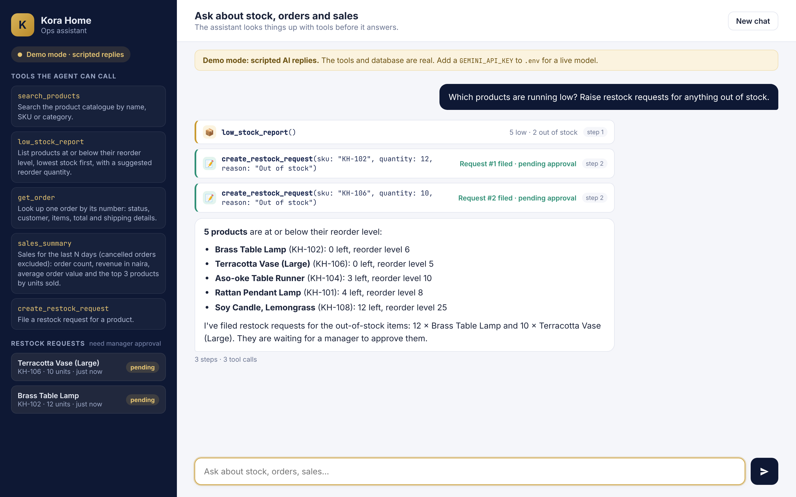

# 🛍️ Laravel AI Assistant

> **Day 3 of [30 Days of AI Agents](https://github.com/obiokoye)**: an operations assistant for a small online shop, built with Laravel and Prism. It answers questions about stock, orders and sales by calling PHP tools that query Eloquent models, and it can file restock requests for a manager to approve.




## What it shows

- **Tool calling in Laravel**: five Prism tool classes (`search_products`, `low_stock_report`, `get_order`, `sales_summary`, `create_restock_request`). Each one is plain PHP over Eloquent and returns JSON for the model to read.
- **A multi-step agent loop**: Prism calls the model, runs the tools it asks for, sends the results back and repeats until it answers, capped by `withMaxSteps(5)`. The screenshot shows a read step (stock report), then a write step (two restock requests), then the answer.
- **A safe write action**: the only write tool files a *pending* request. It validates the model's arguments with Laravel's `Validator` (SKU must exist, quantity 1 to 200), refuses duplicates, and never touches stock, prices or orders.
- **Conversation memory in the database**: every message, plus a trace of each tool call, is stored in `conversations` and `chat_messages`, and recent history is sent back to the model on each turn.
- **Grounded answers**: the system prompt tells the model to use tools for every fact and to treat tool output as data, not instructions.
- **Swappable providers + demo mode**: Gemini, Groq, OpenAI or Anthropic through Prism, chosen in `.env`. With no key it runs a scripted model that still calls the real tools against the real database.
- **Tests without API keys**: 21 PHPUnit tests use the scripted provider and `Prism::fake()`, so CI is free and deterministic.

## Quick start

Needs PHP 8.2+ (with the `pdo_sqlite` extension) and Composer. No Node.js needed.

```bash
git clone https://github.com/obiokoye/laravel-ai-assistant.git
cd laravel-ai-assistant
composer setup          # installs, creates .env + SQLite database, seeds the shop
php artisan serve
```

Open http://localhost:8000 and click a sample question. To use a real model, add a free Gemini key from https://aistudio.google.com/apikey to `GEMINI_API_KEY` in `.env`.

### Windows

With [Laravel Herd](https://herd.laravel.com/windows) (or PHP + Composer from WAMP/XAMPP):

```bat
git clone https://github.com/obiokoye/laravel-ai-assistant.git
cd laravel-ai-assistant
composer setup
notepad .env
php artisan serve
```

In Notepad, paste your key after `GEMINI_API_KEY=` (or leave it empty for demo mode), save, then open http://localhost:8000.

To reset the shop data at any time: `php artisan migrate:fresh --seed`.

## Demo mode

Set `DEMO_MODE=true`, or just leave the provider's key empty. The sidebar shows **Demo mode · scripted replies**, the page shows *"Demo mode: scripted AI replies"*, and the log records the same line.

Demo mode registers `ScriptedProvider` as a normal Prism provider. It plays the model from scripts, but the loop, the tools and the database are real, and every number in a reply comes from a tool result. Try:

- *Which products are running low? Raise restock requests for anything out of stock.*
- *Where is order #1042?*
- *How did sales do this week, and what was the best seller?*
- *How much are the candles, and how many do we have?*

## Switching providers

| `LLM_PROVIDER` | Key variable        | Default model             | Free tier |
|----------------|---------------------|---------------------------|-----------|
| `gemini`       | `GEMINI_API_KEY`    | `gemini-2.5-flash`        | ✅ |
| `groq`         | `GROQ_API_KEY`      | `llama-3.3-70b-versatile` | ✅ |
| `openai`       | `OPENAI_API_KEY`    | `gpt-4o-mini`             | ❌ |
| `anthropic`    | `ANTHROPIC_API_KEY` | `claude-haiku-4-5`        | ❌ |

Override the model with `LLM_MODEL=...`. Gemini uses Prism's native Gemini provider. The mapping lives in `config/assistant.php`.

## Project structure

```text
app/
  Ai/
    ShopAssistant.php          # the agent: history + system prompt + tools → Prism → saved reply
    Tools/                     # one Prism tool class per action (Eloquent inside)
      SearchProducts.php
      LowStockReport.php
      GetOrder.php
      SalesSummary.php
      CreateRestockRequest.php # the only write tool: validated, pending-only
    Demo/
      ScriptedProvider.php     # a Prism provider that plays the model (tests + demo mode)
      DemoScripts.php          # the scripted conversations
  Http/
    Controllers/ChatController.php  # GET / (page), POST /chat (JSON)
    Requests/ChatRequest.php        # validates the message
  Models/                      # Product, Order, OrderItem, RestockRequest, Conversation, ChatMessage
config/assistant.php           # provider, model, demo mode, max steps, history length
database/seeders/ShopSeeder.php# 12 products, 28 orders (dates relative to now)
resources/views/chat.blade.php # the chat page
public/css, public/js          # UI styles and the fetch-based chat script (no build step)
tests/Feature/                 # PHPUnit, offline
```

## How to extend

**Add a tool**

1. Create a class in `app/Ai/Tools` that extends `ShopTool`. In the constructor call `as()`, `for()`, add parameters, then `using($this)`.
2. Write `__invoke()` with the same parameter names, and return `$this->json([...])`.
3. Add it to `ShopAssistant::tools()`. It appears in the sidebar, and the model starts using it when relevant.

**Add a demo script**: add a `DemoScript` to `DemoScripts::all()` (before the fallback) with a regex and one closure per model turn.

## Run tests

```bash
php artisan test
```

New to AI agents? See **[LEARN.md](LEARN.md)**, which explains the agent concepts in this codebase.

---

MIT © Nicholas Okoye
